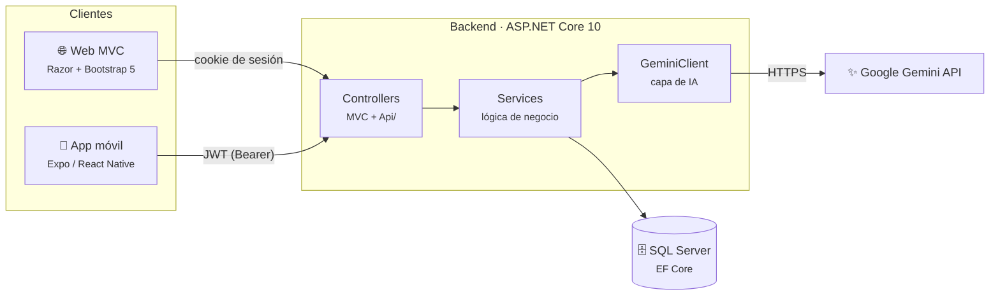
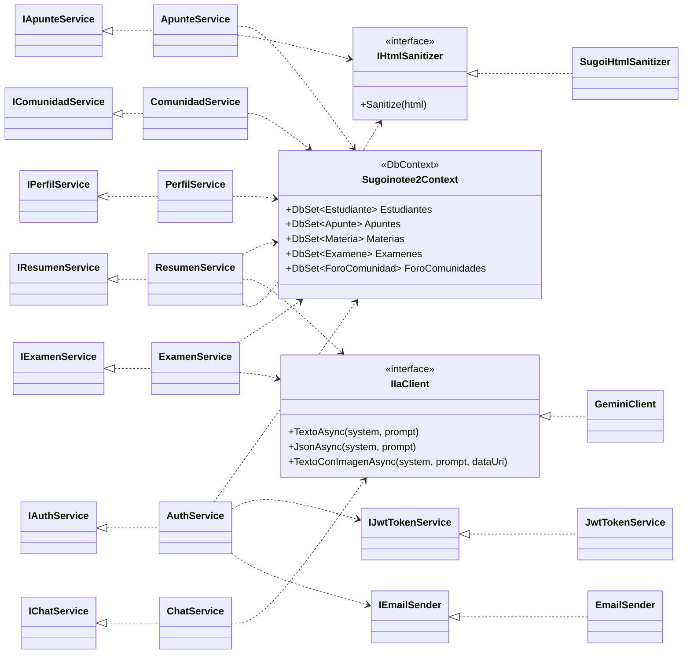
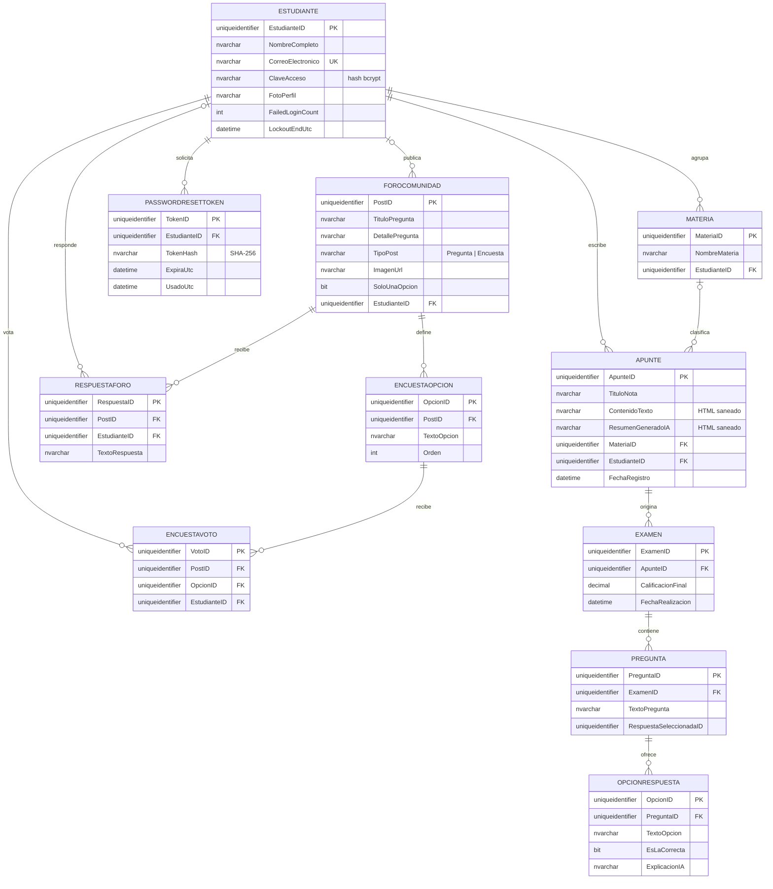

<div align="center">

# SugoiNote

**Plataforma de estudio con inteligencia artificial para estudiantes.**

Apuntes con editor enriquecido · resúmenes y exámenes generados por IA · chat de estudio · comunidad.

[](https://dotnet.microsoft.com/)
[](https://learn.microsoft.com/aspnet/core)
[](https://expo.dev/)
[](https://reactnative.dev/)
[](https://learn.microsoft.com/ef/core/)
[](https://ai.google.dev/)

</div>

---

## Índice

- [¿Qué es SugoiNote?](#qué-es-sugoinote)
- [Características](#características)
- [Arquitectura](#arquitectura)
- [Diagrama de clases](#diagrama-de-clases)
- [Modelo de datos](#modelo-de-datos)
- [API REST](#api-rest)
- [Stack tecnológico](#stack-tecnológico)
- [Puesta en marcha](#puesta-en-marcha)
- [Despliegue](#despliegue)
- [Estructura del proyecto](#estructura-del-proyecto)
- [Estado del proyecto](#estado-del-proyecto)
- [Documentación](#documentación)

---

## ¿Qué es SugoiNote?

SugoiNote es una aplicación pensada para el estudiante: concentra en un solo lugar
sus **apuntes**, los **resúmenes** y **exámenes** que genera la IA a partir de ellos,
un **chat de estudio** para resolver dudas y una **comunidad** donde preguntar y
responder.

El proyecto se compone de **tres capas** que comparten un mismo backend:

| Capa | Tecnología | Carpeta |
|---|---|---|
| **API / Backend** | ASP.NET Core 10 (Web API + MVC) | raíz del proyecto |
| **Web** | Razor Views + Bootstrap 5 + tema claro/oscuro | `Views/`, `wwwroot/` |
| **Móvil** | Expo SDK 57 / React Native 0.86 | `mobile/` |

La web se autentica con **cookie de sesión** y la app móvil con **JWT**: ambas usan
los mismos controladores y la misma capa de servicios.

---

## Características

### 📝 Apuntes
- Editor de bloques (rich-text) con importación de **PDF** y **DOCX**.
- Organización por **materias**, creadas al vuelo desde el propio formulario.
- Autoguardado y **sanitizado del HTML** antes de persistir (anti-XSS).

### 🤖 Inteligencia artificial (Google Gemini)
- **Resúmenes** de un apunte a partir de su contenido.
- **Exámenes** de opción múltiple (tipo, cantidad y apunte configurables),
  con calificación automática y explicación por respuesta.
- **Chat de estudio** con contexto.
- Análisis de **imágenes** adjuntas (visión) para generar contenido.

### 👥 Comunidad
- Feed paginado de **preguntas** y **encuestas**.
- Respuestas, votación única por estudiante e imagen de portada.
- Cada estudiante puede eliminar sus propias publicaciones.

### 🔐 Seguridad
- Autenticación dual (cookie + JWT) con los **mismos `[Authorize]`**.
- **Lockout** tras 5 intentos fallidos (10 minutos).
- **Rate limiting**: login 10/5 min · IA 20/min · global 120/min por IP.
- Antifalsificación global, cabeceras de seguridad y **CSP**.
- Contraseñas con **bcrypt**; restablecimiento por token de un solo uso.
- Aislamiento por propietario (un recurso ajeno devuelve **404**, no 403).

### 📱 App móvil (Expo)
7 pestañas — Inicio, Apuntes, Resúmenes, Exámenes, Chat, Comunidad y Perfil — con
tema claro/oscuro, sesión en `expo-secure-store`, React Query para datos remotos y
el editor rich-text embebido vía **WebView**.

---

## Arquitectura



**Principios de diseño**

- **Toda la lógica vive en `Services/`**: los controladores solo orquestan la
  petición y devuelven la respuesta. La web y la API móvil **reutilizan los mismos
  servicios**, así que el comportamiento es idéntico en ambas capas.
- **La IA está detrás de una interfaz** (`IIaClient`). Cambiar de proveedor no
  toca los servicios que la consumen.
- **Resiliencia** en la llamada a la IA con *retry* y *circuit breaker* (Polly).
- **Sanitizado** de todo el HTML generado o guardado (`HtmlSanitizer`).

---

## Diagrama de clases

Vista de la capa de servicios y sus dependencias principales:



---

## Modelo de datos

Esquema relacional (SQL Server, gestionado con **EF Core Migrations**):



> **Nota de integridad.** `PREGUNTA.RespuestaSeleccionadaID` guarda la opción elegida
> **sin clave foránea** a propósito; el servicio de calificación valida que la opción
> pertenezca a la pregunta antes de escribir.

---

## API REST

La app móvil consume una API REST documentada de forma interactiva en **`/swagger`**.
Son **28 endpoints** agrupados por área:

| Recurso | Método y ruta | Descripción |
|---|---|---|
| **Auth** | `POST /api/auth/registrar` | Registro de estudiante |
| | `POST /api/auth/login` | Inicio de sesión (devuelve JWT) |
| | `GET /api/auth/me` | Datos del estudiante autenticado |
| **Apuntes** | `GET /api/apuntes` | Listado de apuntes |
| | `GET /api/apuntes/materias` | Materias del estudiante |
| | `POST /api/apuntes` | Crear apunte |
| | `GET /api/apuntes/{id}` | Obtener un apunte |
| | `POST /api/apuntes/{id}/autosave` | Autoguardado del editor |
| | `DELETE /api/apuntes/{id}` | Eliminar apunte |
| **Resúmenes** | `GET /api/resumenes` | Listado de resúmenes |
| | `GET /api/resumenes/{apunteId}` | Resumen de un apunte |
| | `GET /api/resumenes/apuntes` | Apuntes disponibles para resumir |
| | `POST /api/resumenes/generar` | Generar resumen con IA |
| **Exámenes** | `GET /api/examenes` | Listado con notas |
| | `POST /api/examenes/generar` | Generar examen con IA |
| | `GET /api/examenes/{id}` | Obtener examen |
| | `POST /api/examenes/{id}/calificar` | Calificar respuestas |
| **Chat** | `POST /api/chat/enviar` | Enviar mensaje al chat de IA |
| **Comunidad** | `GET /api/comunidad` | Feed paginado |
| | `GET /api/comunidad/{id}` | Detalle de la publicación |
| | `POST /api/comunidad/posts` | Crear pregunta |
| | `POST /api/comunidad/encuestas` | Crear encuesta |
| | `POST /api/comunidad/{id}/responder` | Responder |
| | `POST /api/comunidad/{id}/votar` | Votar en encuesta |
| | `DELETE /api/comunidad/{id}` | Eliminar publicación propia |
| **Perfil** | `GET /api/perfil` | Datos y estadísticas |
| | `PUT /api/perfil` | Actualizar datos |
| | `PUT /api/perfil/foto` | Actualizar avatar |

---

## Stack tecnológico

| Área | Tecnología |
|---|---|
| Lenguaje | C# 13 · .NET 10 |
| Backend | ASP.NET Core (MVC + Web API), EF Core 10, Polly |
| Base de datos | SQL Server (MonsterASP) |
| Seguridad | Cookie + JWT, BCrypt, Rate Limiting, HtmlSanitizer |
| IA | Google Gemini (`generativelanguage.googleapis.com`) |
| Correo | MailKit |
| Documentación API | Swashbuckle (Swagger UI) |
| Observabilidad | Serilog |
| Web | Razor Views, Bootstrap 5, CSS con tokens (claro/oscuro) |
| Móvil | Expo SDK 57, React Native 0.86, Expo Router, React Query, TypeScript |

---

## Puesta en marcha

### Requisitos
- [.NET SDK 10](https://dotnet.microsoft.com/download)
- [Node.js 20+](https://nodejs.org/) (para la app móvil)
- Una base de datos SQL Server accesible

### 1. Configurar los secretos

Los secretos **no viven en el repositorio**. En desarrollo se guardan con
*User Secrets*:

```bash
cd SUGOINOTE2
dotnet user-secrets set "ConnectionStrings:DefaultConnection" "Server=...;Database=...;User Id=...;Password=...;TrustServerCertificate=True"
dotnet user-secrets set "IA:ApiKey" "<TU_API_KEY_DE_GEMINI>"
dotnet user-secrets set "Jwt:Key" "<CLAVE_ALEATORIA_DE_32+_CARACTERES>"
```

### 2. Levantar el backend + la web

```powershell
.\iniciar.ps1     # API + Expo en dos ventanas
.\reiniciar.ps1   # los reinicia
.\detener.ps1     # los detiene
```

- Web y API: <http://localhost:5199>
- Swagger: <http://localhost:5199/swagger>

Las migraciones se aplican solas al arrancar (`MigrateAsync()`).

### 3. Levantar la app móvil

```bash
cd SUGOINOTE2/mobile
npm install
npx expo start
```

Con **Expo Go**, escribe `exp://<TU-IP-DE-RED>:8081` (el celular y la PC en la
misma red WiFi). En builds de EAS la URL de la API se define con la variable de
entorno `EXPO_PUBLIC_API_URL`.

> El detalle del móvil está en [`SUGOINOTE2/mobile/README.md`](SUGOINOTE2/mobile/README.md).

---

## Despliegue

El backend se publica en **MonsterASP** mediante **deploy desde Git** (la
plataforma clona el repositorio y publica el proyecto). La configuración de
producción se inyecta por **variables de entorno** (formato `Sección__Clave`):

| Variable | Obligatoria | Descripción |
|---|:---:|---|
| `ASPNETCORE_ENVIRONMENT` | ✅ | `Production` |
| `ConnectionStrings__DefaultConnection` | ✅ | Cadena de conexión a SQL Server |
| `IA__ApiKey` | ✅ | API key de Google Gemini |
| `Jwt__Key` | ✅ | Clave de firma JWT (32+ caracteres) |
| `App__UrlBase` | ➖ | URL pública (p. ej. `https://sugoinote.runasp.net`) |
| `Email__*` | ➖ | Datos SMTP para el correo de restablecimiento |

La plantilla `SUGOINOTE2/appsettings.Production.example.json` documenta la forma
de cada valor (sin credenciales reales). **No se sube al servidor.**

---

## Estructura del proyecto

```
SugoiNote/
├─ SUGOINOTE2/
│  ├─ Controllers/          MVC (web) y Api/ (REST)
│  ├─ Services/             lógica de negocio por área
│  │  ├─ Apuntes/  Auth/  Chat/  Comunidad/
│  │  ├─ Examenes/  Perfiles/  Resumenes/
│  │  ├─ Ia/               cliente de Google Gemini
│  │  └─ Common/           utilidades, opciones, saneador
│  ├─ Models/               entidades EF Core + DbContext
│  ├─ Migrations/           migraciones de EF Core
│  ├─ Views/                vistas Razor
│  ├─ wwwroot/              css, js, librerías vendorizadas
│  ├─ mobile/               app Expo (ver mobile/README.md)
│  │  ├─ src/app/           rutas (Expo Router): (auth), (tabs)
│  │  ├─ src/api/           cliente HTTP con JWT y DTOs
│  │  ├─ src/components/    componentes UI base
│  │  ├─ src/hooks/         useAuth y otros hooks
│  │  └─ src/theme/         tokens y ThemeProvider (claro/oscuro)
│  ├─ Program.cs            arranque y configuración de servicios
│  └─ iniciar.ps1 · reiniciar.ps1 · detener.ps1
├─ DESARROLLO.md            informe técnico para el equipo
└─ SUGOINOTE2.slnx
```

---

## Estado del proyecto

| Componente | Estado |
|---|:---:|
| Backend + Web (MVC) | 🟢 Operativo (local) |
| API REST para el móvil | 🟢 Operativa (28 endpoints) |
| App móvil (Expo) | 🟢 Fases 0–8 completadas |
| Migración de IA a Google Gemini | 🟢 Completada |
| Despliegue en producción (MonsterASP) | 🟡 En preparación |
| Build de la APK (EAS) | 🟡 Pendiente de ejecutar |

---

## Documentación

| Documento | Para quién | Contenido |
|---|---|---|
| **`README.md`** | Usuarios y revisores | Visión general, arquitectura, diagramas y puesta en marcha |
| [`DESARROLLO.md`](DESARROLLO.md) | Equipo de desarrollo | Informe técnico: qué se hizo, decisiones, despliegue y pendientes |
| [`SUGOINOTE2/mobile/README.md`](SUGOINOTE2/mobile/README.md) | Equipo móvil | Detalle de las fases de la app Expo |

---

<div align="center">
<sub>Proyecto integrador · ASP.NET Core 10 + Expo</sub>
</div>
